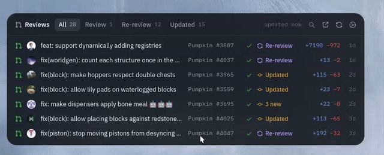

# Megalith Widgets

A desktop widget for GitHub reviews on Linux and macOS. See review requests,
new commits since your last review, CI results and merge conflicts without
keeping GitHub open.



## Linux

Requires Rust 1.88+, GTK 4.12+, libadwaita 1.6+, Pango 1.56+ and
gtk4-layer-shell, including development files.

On Arch Linux:

```sh
sudo pacman -S gtk4 libadwaita gtk4-layer-shell github-cli
gh auth login
./install.sh
```

The installer builds a release binary, installs it to `~/.local/bin` and
registers startup at login. KDE, Xfce, Cinnamon, MATE and LXQt use XDG autostart;
Sway, i3 and Hyprland get a startup command in their existing user configs.
Custom config paths and other WMs need their own startup command:
`~/.local/bin/megalith-widgets`.

GNOME uses the bundled shell extension. Log out and back in if it isn't
detected after installation. Other supported Wayland compositors use layer-shell.

To remove the app, run `./install.sh --uninstall`. Your settings are kept.

## macOS

Requires macOS 14+ and the Xcode command line tools.

```sh
brew install gh
gh auth login
cd macos
./build.sh --install
```

Installs to `/Applications`. The menu bar item provides settings and quit;
startup at login and desktop widget avoidance are available in settings.

## Settings

Add repositories with `owner/repo` or a GitHub URL. Adjust notifications,
refresh interval, draft visibility and appearance from the gear menu.
For a custom position, click **Set position**, drag the **Reviews** title,
then **Save position** to lock it.

## License

Copyright (c) 2026 MegalithOfficial. [GPL-3.0-only](LICENSE).

[Octicons](https://github.com/primer/octicons) use the MIT License.
[IBM Plex Sans](https://github.com/IBM/plex) and
[Lilex](https://github.com/mishamyrt/Lilex) use the SIL Open Font License.
